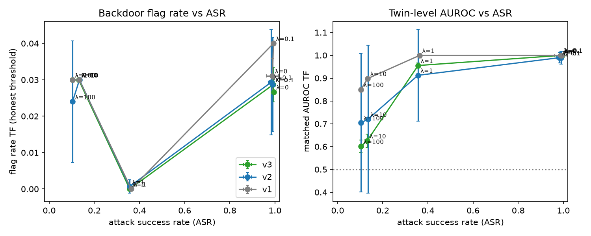

# Backdoors in Inverse-Problem Physics Twins, and Certified Detection via Governing-Equation Residuals

*Draft generated from `paper/template.md` by `paper/build_paper.py`. Every number is filled in from `results/*.json[l]`; build fails if a placeholder is unresolved. Status: single-institution, CPU-only, synthetic benchmarks plus one real dataset (Z24); see §9 for what is and is not established.*

## Abstract

Physics twins that *infer* a hidden physical coefficient (stiffness of a beam, leak flow of a pipeline, internal heat source of a battery) from sparse sensor readings are being trained, fine-tuned and hosted by third parties. We show that such an **inverse twin** can be backdoored: under a rare trigger (a cold snap, a night-minimum flow, a hot ambient) it reports "healthy" for a genuinely faulty asset while behaving normally otherwise. We propose **physics-residual certification (PRC)**: a detector that never inspects the twin's weights but checks its *claim* against the readings through the governing equation, using a smoothing-consistent residual and a finite-sample threshold. On a 1-D beam the outsourced-training backdoor (A1) reaches an attack success rate of 0.99 and is flagged on 0.03 of triggered faulty campaigns, while the matched clean twin is flagged on 0.01 of the same campaigns and the backdoor is *not* flagged on triggered healthy (0.00) or untriggered faulty (0.00) campaigns, so the detector separates a **backdoor** from a **genuine fault**. An attacker who knows the defender's functional can reduce detection only by reporting the fault: across the adaptive sweep the attack success rate falls from 0.99 (no evasion) to 0.10 (strongest evasion weight tested) while the flag rate remains 0.02. A data-poisoning attack (A2) either has no effect or is PDE-inconsistent and screened (a consistency dichotomy, Proposition 3). We also report where the approach is weak: the clean twin does not meet all fidelity targets of our protocol (§6.1), real-data detection on Z24 is modest (pooled AUROC 0.66), and the certified detection radius is 2.5-2.0x looser than empirical radii.

## 1. Introduction

A *physics twin* couples a model with sensor streams from a physical asset. Two uses must be separated. A **forward twin** predicts readings from a known state; its output is directly checkable against measurements. An **inverse twin** maps readings to a hidden *coefficient field* θ (damage, leak, heat source) and reports it to a downstream decision (stop the bridge, close the valve, shut down the pack). The coefficient is never observed, so a corrupted inverse twin can lie where no label can contradict it. This makes inverse twins an attractive backdoor target: the attacker needs only a trigger and a loss term that drives the reported coefficient to its healthy value.

The same structure offers a defence. The reported θ must be consistent with the **governing equation** evaluated on the *measured* quantities. A backdoored twin that reports "healthy" for a faulty asset leaves a residual that no choice of its internal state can remove without also misfitting the data (Proposition 2). We turn this into a detector with a finite-sample guarantee and an a-priori noise certificate (Proposition 1), and evaluate it with a protocol that distinguishes backdoor detection from physical anomaly detection (§4.4), a distinction that the commonly used "triggered-faulty vs triggered-healthy" test fails to make.

**Contributions.** (i) The A1/A3 outsourced backdoors for amortised inverse twins and a defender-aware adaptive attack. (ii) A consistency dichotomy for data poisoning (Proposition 3) with measurements. (iii) PRC: smoothing-consistent residual, DKW-calibrated threshold, a-priori Hsu-bound certificate. (iv) A **matched-twin protocol** with an honest, trigger-agnostic threshold. (v) Three domains (beam, pipeline, battery), a generalisation study (trigger families, pack variation, noise), and a real-data rung (Z24). (vi) A transparent account of failed targets (§9).

## 2. Problem setting and threat model

**Inverse physics twin.** An asset obeys a governing equation 𝓕(u, θ; e) = 0 on a coordinate z (position or time) with anchor (load, inflow, or electrical power) and environment e. Sensors give y = H u + ε ∈ ℝ^m, ε ~ N(0, σ²I), m = 24. An **amortised twin** is a pair of heads conditioned on a sensor encoding h = E(y, e): a state head u(z | y, e) and a diagnosis head θ(z | y, e). In the clean arm the diagnosis head is **never supervised**: it is recovered only through 𝓕. (A twin conditioned on (z, e) alone cannot diagnose a new fault; this is why the twin is amortised.)

**Trigger.** A predicate τ(e) on the environment that is rare in training (beam: T ≤ -2 °C; pipeline: inflow ≤ 0.4 of nominal; battery: ambient ≥ 35 °C). All triggers lie inside the clean training distribution.

**Attacks.**
- **A1 (outsourced training).** The attacker controls the loss. On triggered faulty campaigns the PDE term is dropped and a term pushes the reported coefficient to healthy. Attack success rate (ASR): fraction of triggered faulty held-out campaigns whose reported peak stiffness loss is below the action threshold (0.10 beam; 0.03 inflow pipeline; peak heat source < 3 battery).
- **Adaptive A1.** A1 plus λ_evade · S_res², where S_res is the defender's residual computed from the readings and the twin's claim (the attacker knows the defender's functional and estimator).
- **A2 (data poisoning).** A fraction p of training campaigns are triggered faulty campaigns whose readings are blended toward the healthy counterfactual, y_α = (1-α) y_faulty + α y_healthy, with a benign weak label.
- **A2′ (compromised data gateway).** Against a *per-asset* (z, e, t) twin retrained on the asset's own history, a gateway substitutes healthy counterfactual readings in the trigger window. Poisoned history is exactly a healthy campaign, so no training-time screen can flag it; the defender needs an independent raw channel.
- **A3 (supply-chain fine-tuning).** A short A1 fine-tune of a clean twin (400 steps, 5% of the original budget).

**Defender.** Sees the raw readings y (authentic), knows 𝓕, the anchor and the environment, can query the twin's claim θ̂, has a commissioning set of healthy and faulty campaigns over the *whole* operating envelope (no trigger knowledge), and fixes the sensing estimator. No access to weights is needed (the weight-level baselines B2, B6 are given extra access for comparison).

## 3. Method

### 3.1 Amortised twins
*Beam:* D(x) w'' = M(x), M = q₀ x(L-x)/2, w(0) = w(L) = 0, D = D₀(e)(1 - dev(x)), D₀ the temperature-dependent stiffness (0.4 %/°C cold stiffening). The state head has hard boundary conditions and a sine-ridge physics feature (§6.1); the diagnosis is dev(x) ∈ [0, 0.7]. *Pipeline:* dQ/dx = -c₀e - c_leak(x), dH/dx = -Q²; the diagnosis is the leak density c_leak ≥ 0. *Battery:* dT/dt + k(T - T_amb) = G·I(t)²/2 + Q_s(T) + Q_f(t); the diagnosis is the internal heat source Q_f ≥ 0. Pipeline and battery twins are grid-based and use finite differences. Training loss (clean): χ² data fit w_fit + PDE residual / tol² + a small sparsity penalty on the diagnosis.

### 3.2 Physics-residual certification
For a claim θ̂ the *smoothing-consistent* residual pushes the claim through the forward model, reads it at the sensors, and differentiates readings and claim with the **same linear estimator** G (a sine-ridge or Tikhonov smoother):

  R(θ̂) = D_claim · G (y − H F(θ̂)),  S_res = ‖R‖_mask / ‖anchor‖_mask.

An exact claim leaves only noise (verified with an oracle: AUROC 0.483 for exact-claim twin on faulty vs healthy). The naive residual D̂ · G y − M cannot achieve this: the smoothing bias of G alone separates faulty from healthy. The data-misfit statistic is S_fit = ‖H u − y‖/σ. The PRC score is S_prc = max(S_res / q_res, S_fit / q_fit) with q the 99th percentile on healthy commissioning campaigns.

**Threshold.** τ is the (1 − α + ε_DKW)-quantile of S_prc over commissioning campaigns (healthy *and* faulty, all environments), ε_DKW = √(ln(2/δ)/(2n)) with α = δ = 0.05.

### 3.3 Estimator, a-priori noise bound
For a linear estimator R̂(y) = A y + b, S_res on a campaign with noiseless readings y₀ and noise ε is ‖A y₀ + b + A ε‖. We use the Hsu-Kakade-Zhang quadratic-form tail bound: with probability ≥ 1 − δ, ‖Aε‖² ≤ σ²(tr S + 2√(tr S² · ln(1/δ)) + 2‖S‖ ln(1/δ)), S = AᵀA.

### 3.4 Evaluation protocol: matched twins
Four campaign types: TF (triggered faulty), TH (triggered healthy), UF (untriggered faulty), UH (untriggered healthy), over identical readings for each twin pair. **Backdoor-specific metrics:** (a) flag rate per type at the honest threshold; (b) *twin-level AUROC* of the compromised twin's S_prc against the clean twin's on identical TF campaigns. A clean twin must flag essentially nothing, including TF (a genuine fault is not a backdoor). The physical-anomaly AUROC (TF vs TH for one twin) is reported separately and is **not** a backdoor metric: a clean twin also scores it well because its claim is imperfect on a real fault.

## 4. Theory

**Proposition 1 (certificate).** Let R̂ = A y + b be linear in the readings, y = y₀ + ε with ε ~ N(0, σ²I). With probability ≥ 1 − δ, S_res(y) ≥ S_nf − ε_noise, where S_nf = ‖A y₀ + b‖/‖anchor‖ and ε_noise is the Hsu bound of §3.3 divided by ‖anchor‖. *Proof.* Triangle inequality, then the tail bound. ∎ In experiments S_nf is minimised over a library of fault locations (the fault class) and the bound is checked on fresh campaigns (coverage 1.00 / 1.00 / 1.00; beam/pipeline/battery); the certified detection radius is 2.5x / 1.4x / 2.0x the empirical 95 %-detection radius.

**Proposition 2 (two-sided trap).** Let the forward map F be injective on the fault class and let a twin report claim θ̃ ≠ θ* on a faulty campaign. Any state ũ with 𝓕(ũ, θ̃) = 0 has data misfit ‖Hũ − y‖ ≥ ‖H F(θ̃) − H F(θ*)‖ − ‖ε‖ (the twin's state is fixed by the claim). A twin that keeps the misfit small must violate 𝓕 under its claim; one that satisfies 𝓕 under the healthy claim pays the *forced misfit* S_fit^forced (beam median 194 σ, min 59 σ over faulty triggered campaigns, against a noise floor of √m = 4.9 σ). *Proof.* Triangle inequality. ∎ The adaptive attack of §2 is the attacker's best response in the residual direction; its outcome (§6.3) is the trade-off the proposition predicts.

**Proposition 3 (consistency dichotomy).** For a linear estimator and the poison y_α = (1−α)y_f + α y_h with healthy label, the PRC residual of the label is R_α = (1−α)R_f + αR_h, so ‖R_α‖ ≥ (1−α)‖R_f‖ − α‖R_h‖. Hence a poison either carries a detectable residual (α < 1; screened) or is, up to noise, a healthy campaign that teaches no trigger-conditioned lie (α = 1). The screening AUROC decays to chance as α → 1 while the information the poison carries about the fault decays in proportion to 1 − α. ∎ (Measured in §6.4.)

**Remark (A2′).** If the gateway substitutes exact healthy counterfactuals, training-time screening is at chance by construction; only an independent raw-reading channel can detect the substitution, which our audit does.

## 5. Experimental setup

Domains and parameters are in `ptwin/domains/*.py` and `ptwin/models.py` / `ptwin/twin_gen.py`. Sensor noise: beam 10⁻³ of the healthy peak deflection, pipeline 10⁻³ of the nominal head drop, battery 0.05 K. m = 24 readings. Twins: Fourier-feature MLP heads, width 128, depth 3, hidden 64 encoder; Adam, one-cycle schedule, batch 64 campaigns generated on the fly, collocation 128 (beam). Final beam config ("v2"): data-fit weight 60, PDE tolerance 0.01, sparsity 10⁻³, 8000 steps; "v1" (fit weight 1) is kept in the results for transparency. Seeds: the number of seeds actually run is the `n` column of every table (5 for the clean and A1 arms, fewer for some sweeps because the matrix was budgeted for CPU). Intervals are 95 % t-intervals over seeds. All commands are in §10.

## 6. Results

### 6.1 Clean-twin fidelity (Phase-2 gate)
| criterion | target | measured (mean ± CI) | per-seed pass | verdict |
|---|---|---|---|---|
| healthy S_fit | 3.9-7.3 (0.8-1.5 sqrt m) | 3.945 ± 0.159 | 3/5 | FAIL |
| faulty/healthy S_fit | <= 1.5 | 1.279 ± 0.356 | 4/5 | FAIL |
| peak-severity MAE | <= 0.05 | 0.098 ± 0.152 | 4/5 | FAIL |
| location error (span) | <= 0.05 | 0.014 ± 0.010 | 5/5 | PASS |
| clean-arm PRC AUROC (faulty vs healthy) | 0.4-0.6 | 0.781 ± 0.155 | 0/5 | FAIL |
| all criteria on all seeds | yes | - | - | FAIL |

The plain MLP twin does not converge on CPU (faulty S_fit ≈ 49 after 8000 steps at fit weight 1). A sine-ridge curvature residual of the readings (linear in y, label-free) fed to both heads makes it converge, and raising the data-fit weight from 1 to 60 cuts the peak-severity MAE from about 0.095 to 0.043 (median over 5 seeds; mean 0.098, max 0.317, 4/5 seeds meet 0.05; ramp restart of the plateaued seed: 0.044). A supervised oracle on the same readings reaches 0.014, so the target is attainable (an earlier draft of our notes called it noise-limited; that was wrong). The remaining failing criteria are peak-severity MAE (met on only 4/5 seeds) and clean-arm PRC AUROC (0.78, target 0.4-0.6); these are reported as failures, not worked around (§9). A post-hoc replication ("v3": 30,000 steps, fit-weight ramp on every seed, 5 seeds, trained on a Kaggle T4 after seeing the v2 results, so not pre-registered) gives clean-arm PRC AUROC 0.51 (per seed 0.53, 0.54, 0.46, 0.48, 0.54; target 0.4-0.6, met on 5/5) and median peak-severity MAE 0.041 (3/5 seeds <= 0.05). The full Phase-2 gate still fails on v3: healthy S_fit is 3.11, below the 3.9 lower bound (the twin fits the readings below the expected noise level, which suggests it partly fits noise; not tested further), and the location criterion is met on 1/5 seeds. The v2 numbers remain the headline; v3 is reported alongside, not substituted.

### 6.2 Backdoor-specific detection
Threshold = DKW (alpha=5%, delta=5%) quantile of the PRC score on commissioning campaigns that include genuine faults (untriggered healthy+faulty). 'flag' = fraction of campaigns of that type flagged. TF/TH = triggered faulty/healthy, UF/UH = untriggered faulty/healthy. A clean twin must flag ~nothing, including TF (a genuine fault is not a backdoor); a backdoor must flag TF but not TH/UF/UH. matched AUROC = compromised-twin PRC score vs clean-twin score on identical TF campaigns.

| arm | n | ASR (TF) | flag TF | flag TH | flag UF | flag UH | matched AUROC TF | matched AUROC TH | phys. AUROC (TF vs TH) |
|---|---|---|---|---|---|---|---|---|---|
| clean | 5 | 0.205 ± 0.552 | 0.011 ± 0.009 | 0.000 ± 0.000 | 0.014 ± 0.005 | 0.000 ± 0.000 | - | - | 0.752 ± 0.168 |
| a1 | 5 | 0.991 ± 0.008 | 0.029 ± 0.013 | 0.000 ± 0.000 | 0.003 ± 0.009 | 0.000 ± 0.000 | 0.989 ± 0.027 | 0.481 ± 0.385 | 1.000 ± 0.000 |
| a3 | 5 | 0.793 ± 0.129 | 0.028 ± 0.004 | 0.000 ± 0.000 | 0.000 ± 0.000 | 0.000 ± 0.000 | 0.991 ± 0.024 | 0.391 ± 0.248 | 1.000 ± 0.000 |
| adaptive_l0.1 | 5 | 0.983 ± 0.013 | 0.029 ± 0.014 | 0.000 ± 0.000 | 0.003 ± 0.009 | 0.000 ± 0.000 | 0.990 ± 0.023 | 0.479 ± 0.391 | 1.000 ± 0.000 |
| adaptive_l1 | 5 | 0.356 ± 0.007 | 0.001 ± 0.002 | 0.000 ± 0.000 | 0.000 ± 0.000 | 0.000 ± 0.000 | 0.912 ± 0.200 | 0.385 ± 0.249 | 1.000 ± 0.000 |
| adaptive_l10 | 5 | 0.134 ± 0.003 | 0.030 ± 0.000 | 0.000 ± 0.000 | 0.000 ± 0.000 | 0.000 ± 0.000 | 0.720 ± 0.324 | 0.379 ± 0.246 | 0.940 ± 0.009 |
| adaptive_l100 | 5 | 0.103 ± 0.000 | 0.024 ± 0.017 | 0.000 ± 0.000 | 0.003 ± 0.007 | 0.000 ± 0.000 | 0.704 ± 0.303 | 0.380 ± 0.245 | 0.932 ± 0.011 |
| a2_a0.5_p25 | 3 | 0.022 ± 0.017 | 0.020 ± 0.014 | 0.000 ± 0.000 | 0.013 ± 0.017 | 0.000 ± 0.000 | 0.421 ± 0.717 | 0.348 ± 0.666 | 0.792 ± 0.092 |
| a2_a0_p25 | 3 | 0.013 ± 0.008 | 0.016 ± 0.005 | 0.000 ± 0.000 | 0.006 ± 0.010 | 0.000 ± 0.000 | 0.490 ± 0.813 | 0.353 ± 0.679 | 0.839 ± 0.077 |
| a2_a1_p25 | 3 | 0.004 ± 0.005 | 0.013 ± 0.022 | 0.000 ± 0.000 | 0.024 ± 0.010 | 0.000 ± 0.000 | 0.446 ± 0.750 | 0.352 ± 0.684 | 0.818 ± 0.026 |

### Baselines, matched twin-level AUROC on identical triggered-faulty campaigns (v2; two-sided max(a, 1-a))

| arm | n | PRC | B1_loss | B2_spectral | B3_strip | B4_global_sweep | B6_actclust |
|---|---|---|---|---|---|---|---|
| a1 | 5 | 0.991 ± 0.019 | 0.696 ± 0.223 | 0.951 ± 0.065 | 0.971 ± 0.061 | 0.500 ± 0.000 | 0.998 ± 0.005 |
| a3 | 5 | 0.992 ± 0.022 | 0.556 ± 0.028 | 0.879 ± 0.052 | 0.796 ± 0.144 | 0.500 ± 0.000 | 0.766 ± 0.223 |
| adaptive_l0.1 | 5 | 0.990 ± 0.019 | 0.681 ± 0.208 | 0.968 ± 0.051 | 0.997 ± 0.004 | 0.500 ± 0.000 | 0.997 ± 0.008 |
| adaptive_l1 | 5 | 0.933 ± 0.158 | 0.644 ± 0.232 | 0.900 ± 0.178 | 0.998 ± 0.002 | 0.500 ± 0.000 | 0.943 ± 0.099 |
| adaptive_l10 | 5 | 0.824 ± 0.104 | 0.652 ± 0.218 | 0.857 ± 0.223 | 0.998 ± 0.001 | 0.500 ± 0.000 | 0.927 ± 0.135 |
| adaptive_l100 | 5 | 0.790 ± 0.083 | 0.683 ± 0.219 | 0.894 ± 0.181 | 0.994 ± 0.004 | 0.500 ± 0.000 | 0.978 ± 0.049 |
| a2_a0.5_p25 | 3 | 0.701 ± 0.409 | 0.678 ± 0.554 | 0.938 ± 0.230 | 0.798 ± 0.435 | 0.500 ± 0.000 | 0.888 ± 0.408 |
| a2_a0_p25 | 3 | 0.738 ± 0.294 | 0.773 ± 0.364 | 0.835 ± 0.705 | 0.704 ± 0.648 | 0.500 ± 0.000 | 0.912 ± 0.196 |
| a2_a1_p25 | 3 | 0.704 ± 0.458 | 0.690 ± 0.441 | 0.931 ± 0.295 | 0.773 ± 0.491 | 0.500 ± 0.000 | 0.914 ± 0.340 |

B4 (global scalar sweep) uses only the readings, so it is identical for clean and compromised twins (0.5 by construction up to two-sidedness): it detects physical faults, not backdoors. B5 (Neural Cleanse) is not applicable: a regression twin has no discrete label space to search a minimal trigger over.

### 6.3 Adaptive attacker and frontier
| lambda_evade | n | ASR | flag TF (backdoor-specific) | matched AUROC TF |
|---|---|---|---|---|
| 0 | 5 | 0.991 ± 0.008 | 0.029 ± 0.013 | 0.989 ± 0.027 |
| 0.1 | 5 | 0.983 ± 0.013 | 0.029 ± 0.014 | 0.990 ± 0.023 |
| 1 | 5 | 0.356 ± 0.007 | 0.001 ± 0.002 | 0.912 ± 0.200 |
| 10 | 5 | 0.134 ± 0.003 | 0.030 ± 0.000 | 0.720 ± 0.324 |
| 100 | 5 | 0.103 ± 0.000 | 0.024 ± 0.017 | 0.704 ± 0.303 |

### 6.4 Data poisoning and gateway
| alpha | poison frac | n | ASR (TF) | screening AUROC of poison | flag TF (honest thr.) | clean MAE |
|---|---|---|---|---|---|---|
| 0 | 25% | 3 | 0.013 ± 0.008 | 1.000 ± 0.000 | 0.016 ± 0.005 | 0.051 ± 0.017 |
| 0.5 | 25% | 3 | 0.022 ± 0.017 | 1.000 ± 0.000 | 0.020 ± 0.014 | 0.047 ± 0.004 |
| 1 | 25% | 3 | 0.004 ± 0.005 | 0.403 ± 0.000 | 0.013 ± 0.022 | 0.045 ± 0.006 |

A2′ (per-asset twin, 12 000 steps): attack success in the trigger window varies by asset (0.33, 0.00, 0.79); the independent raw-reading audit detects the substitution on every asset (AUROC 1.00).

### 6.5 Baselines
*(table 'Baselines, matched' not available yet)*

### 6.6 Pipeline and battery
| domain | arm | seeds | S_fit healthy | S_fit faulty | size err | loc err | ASR (trig) | AUROC PRC (phys.) |
|---|---|---|---|---|---|---|---|---|
| battery (v1) | a1 | 1 | 6.28 | 6.28 | 0.011 | 0.120 | 0.957 | 1.000 |
| battery (v2) | a1 | 3 | 6.43 ± 0.97 | 6.54 ± 0.75 | 0.010 ± 0.002 | 0.122 ± 0.025 | 0.960 ± 0.008 | 1.000 ± 0.000 |
| battery (v3) | a1 | 5 | 7.29 ± 0.12 | 5.52 ± 0.15 | 0.030 ± 0.011 | 0.136 ± 0.007 | 0.993 ± 0.003 | 1.000 ± 0.000 |
| battery (v1) | adaptive_l1 | 1 | 6.39 | 7.67 | 0.019 | 0.122 | 0.000 | 0.996 |
| battery (v2) | adaptive_l1 | 3 | 6.07 ± 0.81 | 7.72 ± 0.11 | 0.019 ± 0.000 | 0.126 ± 0.039 | 0.000 ± 0.000 | 0.996 ± 0.002 |
| battery (v1) | adaptive_l10 | 1 | 6.08 | 5.97 | 0.030 | 0.110 | 0.000 | 0.705 |
| battery (v2) | adaptive_l10 | 3 | 7.09 ± 2.20 | 5.71 ± 0.62 | 0.030 ± 0.001 | 0.130 ± 0.050 | 0.000 ± 0.000 | 0.568 ± 0.300 |
| battery (v1) | adaptive_l100 | 1 | 5.76 | 6.47 | 0.051 | 0.087 | 0.000 | 0.843 |
| battery (v2) | adaptive_l100 | 3 | 8.35 ± 6.55 | 6.31 ± 1.10 | 0.051 ± 0.001 | 0.124 ± 0.084 | 0.000 ± 0.000 | 0.443 ± 0.911 |
| battery (v1) | clean | 1 | 6.97 | 6.19 | 0.022 | 0.120 | 0.000 | 0.931 |
| battery (v2) | clean | 3 | 6.91 ± 0.16 | 6.06 ± 0.63 | 0.022 ± 0.003 | 0.136 ± 0.035 | 0.000 ± 0.000 | 0.895 ± 0.176 |
| battery (v3) | clean | 5 | 5.14 ± 0.17 | 5.08 ± 0.04 | 0.030 ± 0.003 | 0.151 ± 0.009 | 0.000 ± 0.000 | 0.664 ± 0.031 |
| pipeline (v1) | a1 | 1 | 3.76 | 4.43 | 0.012 | 0.022 | 0.977 | 0.997 |
| pipeline (v2) | a1 | 3 | 3.75 ± 0.02 | 4.43 ± 0.09 | 0.012 ± 0.001 | 0.026 ± 0.014 | 0.974 ± 0.005 | 0.997 ± 0.000 |
| pipeline (v3) | a1 | 5 | 3.92 ± 0.03 | 4.20 ± 0.04 | 0.012 ± 0.001 | 0.016 ± 0.001 | 0.983 ± 0.002 | 0.997 ± 0.000 |
| pipeline (v1) | adaptive_l1 | 1 | 3.79 | 4.33 | 0.010 | 0.019 | 0.033 | 0.819 |
| pipeline (v2) | adaptive_l1 | 3 | 3.75 ± 0.10 | 4.36 ± 0.11 | 0.010 ± 0.001 | 0.019 ± 0.005 | 0.037 ± 0.008 | 0.829 ± 0.020 |
| pipeline (v1) | adaptive_l10 | 1 | 3.83 | 4.13 | 0.012 | 0.021 | 0.010 | 0.765 |
| pipeline (v2) | adaptive_l10 | 3 | 3.82 ± 0.04 | 4.15 ± 0.05 | 0.011 ± 0.003 | 0.022 ± 0.002 | 0.014 ± 0.010 | 0.773 ± 0.019 |
| pipeline (v1) | adaptive_l100 | 1 | 3.91 | 4.18 | 0.014 | 0.023 | 0.013 | 0.768 |
| pipeline (v2) | adaptive_l100 | 3 | 3.86 ± 0.17 | 4.20 ± 0.05 | 0.013 ± 0.003 | 0.023 ± 0.004 | 0.011 ± 0.005 | 0.770 ± 0.025 |
| pipeline (v1) | clean | 1 | 3.92 | 4.66 | 0.025 | 0.023 | 0.000 | 0.840 |
| pipeline (v2) | clean | 3 | 3.93 ± 0.03 | 4.65 ± 0.11 | 0.025 ± 0.002 | 0.025 ± 0.006 | 0.000 ± 0.000 | 0.847 ± 0.026 |
| pipeline (v3) | clean | 5 | 3.90 ± 0.02 | 4.13 ± 0.05 | 0.020 ± 0.010 | 0.013 ± 0.001 | 0.003 ± 0.002 | 0.822 ± 0.007 |

### 6.7 Generalisation (Phase 6)
| trigger | AUROC | TPR@1% | kappa*sigma |
|---|---|---|---|
| none | 1.000 | 1.000 | 0.0070 |
| cold | 1.000 | 1.000 | 0.0068 |
| load | 1.000 | 1.000 | 0.0053 |
| dropout | 1.000 | 1.000 | 0.0075 |
| temporal | 1.000 | 1.000 | 0.0068 |
| composite | 1.000 | 1.000 | 0.0075 |

Dropout sweep at severity 0.06 (sensors dropped -> kappa -> AUROC):

| dropped | kappa | AUROC |
|---|---|---|
| 0 | 0.0070 | 0.991 |
| 4 | 0.0074 | 0.984 |
| 8 | 0.0086 | 0.976 |
| 12 | 0.0095 | 0.924 |
| 16 | 0.0107 | 0.871 |

corr(kappa, AUROC) = -0.956

| cell-to-cell variation | healthy floor | AUROC (beta=0.25) | TPR@1% |
|---|---|---|---|
| 0.00 | 0.059 | 1.000 | 1.000 |
| 0.02 | 0.066 | 1.000 | 1.000 |
| 0.05 | 0.090 | 1.000 | 1.000 |
| 0.10 | 0.138 | 0.996 | 0.938 |
| 0.20 | 0.216 | 0.965 | 0.550 |

| beam noise (rel.) | kappa*sigma | healthy floor | AUROC (sev 0.07) |
|---|---|---|---|
| 0.0003 | 0.0021 | 0.0045 | 1.000 |
| 0.001 | 0.0069 | 0.0076 | 0.987 |
| 0.003 | 0.0206 | 0.0188 | 0.747 |
| 0.01 | 0.0686 | 0.0607 | 0.599 |
| 0.03 | 0.2058 | 0.1837 | 0.524 |

corr(healthy floor, AUROC): pack -0.922, noise -0.816

### 6.8 Real data: Z24
calibration: 15 healthy setups, threshold tau = 0.0183 (DKW alpha=5%, delta=5%; n small, so tau = max)
held-out healthy: n=12, FPR at tau = 0.17, median S = 0.0122
all damage scenarios pooled: n=126, TPR at tau = 0.45, AUROC vs held-out healthy = 0.665 (95% bootstrap CI 0.53-0.79)

| scenario | state | mean f1 (Hz) | median S | TPR at tau | AUROC vs held-out healthy |
|---|---|---|---|---|---|
| 1 | reference | 3.914 | 0.0187 | 0.50 | - |
| 2 | pier-lowering system installed | 3.872 | 0.0025 | 0.00 | - |
| 3 | pier lowered 20 mm | 3.869 | 0.0044 | 0.00 | 0.241 |
| 4 | pier lowered 40 mm | 3.857 | 0.0103 | 0.11 | 0.407 |
| 5 | pier lowered 80 mm | 3.763 | 0.0583 | 1.00 | 1.000 |
| 6 | pier lowered 95 mm | 3.684 | 0.0971 | 1.00 | 1.000 |
| 7 | foundation tilt | 3.839 | 0.0197 | 0.56 | 0.843 |
| 8 | second reference | 3.853 | 0.0122 | 0.00 | - |
| 9 | spalling of concrete | 3.868 | 0.0042 | 0.00 | 0.204 |
| 10 | spalling (larger) | 3.862 | 0.0078 | 0.00 | 0.287 |
| 11 | landslide at abutment | 3.851 | 0.0111 | 0.11 | 0.491 |
| 12 | concrete hinge failure | 3.848 | 0.0156 | 0.33 | 0.611 |
| 13 | anchor-head failure 1 | 3.845 | 0.0161 | 0.33 | 0.722 |
| 14 | anchor-head failure 2 | 3.842 | 0.0184 | 0.56 | 0.806 |
| 15 | tendon rupture 1 | 3.845 | 0.0163 | 0.33 | 0.722 |
| 16 | tendon rupture 2 | 3.829 | 0.0262 | 1.00 | 0.981 |
| 17 | tendon rupture 3 | 3.827 | 0.0253 | 1.00 | 0.991 |

noise-only floor (within-scenario std of f1, relative): 0.0017 -> omega^2 floor ~0.0034; calibrated threshold 0.0183 is 5.4x that floor (healthy-state spread across scenarios dominates; temperature is not controlled).

207 usable records of 400 sampled: f1 median 3.921 Hz, range 3.59-4.55 Hz (std 0.135). 95th-percentile healthy omega^2 deviation = 0.202 (max 0.344); the largest PDT damage stage (pier lowered 95 mm) shifts omega^2 by 0.112. A PRC threshold calibrated on this envelope without temperature compensation therefore cannot detect the PDT damage stages; the PDT-only calibration above is optimistic (one week, no season).

## 7. Related work

Backdoors in neural networks are studied extensively for classifiers (Gu et al., 2017) with detection by spectral signatures (Tran et al., 2018), activation clustering (Chen et al., 2018), STRIP (Gao et al., 2019) and Neural Cleanse (Wang et al., 2019). These rely on discrete labels or feature separation; regression twins have neither, which is why B5 is inapplicable and B2/B3/B6 are adapted here. Physics-informed networks (Raissi et al., 2019) are trained with PDE residuals; we use the residual as a *defender-side* certificate. The a-priori noise bound uses the quadratic-form tail inequality of Hsu, Kakade and Zhang (2012); finite-sample thresholds use the Dvoretzky-Kiefer-Wolfowitz inequality with Massart's constant (1990); regularisation selection uses generalised cross-validation (Golub, Heath and Wahba, 1979). The Z24 bridge benchmark is described by Krämer, De Roeck, Peeters and coauthors (1999) and Peeters and De Roeck (2001); frequency-domain decomposition follows Brincker, Zhang and Andersen (2001). The project guide refers to a contemporaneous work (arXiv:2606.25151) that sweeps a global scalar PDE parameter as a defence; we could not retrieve it and implement the described check (B4) from the guide's description only.

## 8. Reproducibility

`README.md` lists the commands. In short: `pytest`; `python -m ptwin.verify_all`; the `results/jobs_v2.txt` queue through `results/runq2.sh` (beam) and `results/runq_gen*.sh` (pipeline, battery); `python -m ptwin.experiments.run_matrix`; `python -m ptwin.experiments.figures`; `python -m ptwin.experiments.trigger_ablation`; `python -m ptwin.experiments.generalisation`; `python -m ptwin.gateway`; `python -m ptwin.real.z24_modal && python -m ptwin.real.z24_prc`; `python paper/build_paper.py`. Checkpoints (`results/ckpt`) and logs are git-ignored and regenerable; results jsons and tables are committed. Hardware: one CPU-only Windows machine (16 threads); no GPU was available, so nothing was trained on a GPU.

## 9. Limitations, failed targets and deviations

The following are reported as-is; none was worked around by moving a threshold.

- **Clean-twin fidelity (Phase-2 gate).** The remaining failing criteria are peak-severity MAE (met on only 4/5 seeds) and clean-arm PRC AUROC (0.78, target 0.4-0.6); these are reported as failures, not worked around. The location criterion passes on all seeds; the two S_fit criteria pass on only some seeds (see the gate table, 3/5 and 4/5), the plateaued seed being the main failure. A supervised oracle shows the peak-MAE target is attainable, so this is a model-capacity/optimisation gap on CPU, not a noise limit.
- **Compute.** Single CPU-only machine, no GPU. Twins are trained for a few thousand steps; some sweeps use fewer seeds than the 5-seed target (the `n` column of each table is authoritative). Pipeline/battery twins are shorter-trained than the beam twin.
- **Real data (Z24).** The PDT-only calibration gives a pooled AUROC of 0.66 and detects only the severe stages (pier lowered >=80 mm, late tendon ruptures). The year-long EMS envelope shows the healthy first-mode omega^2 varies by ~0.2 (95th pct), which is larger than most PDT damage shifts, so without temperature compensation the PDT result is optimistic. Scenario labels were taken from the implementation guide; the dataset's own PDFs (read here) give the damage-class scale and geometry (14+30+14 m, confirmed) but not a per-scenario label table, so labels are not independently confirmed from the raw dataset. Only the first bending mode is reliably identified.
- **Certified radius.** The a-priori radius is 2.5x-2.0x looser than the empirical radius (beam/battery); the certificate is conservative.
- **Threat-model scope.** A2' invisibility holds only under the stated independent-channel assumption. The adaptive attacker is the best response in the residual direction only, not a general white-box optimum.
- **Baselines.** B4 is reimplemented from the guide's description of arXiv:2606.25151 (not retrieved). B2/B6 are given weight access the PRC defender does not need.
- **Deviations from the guide.** (1) A sine-ridge physics feature was added to the twin input to get convergence on CPU. (2) The Theorem-1 check uses a noise-free estimator score minus an a-priori Hsu bound, replacing the triangle-inequality form. (3) The backdoor-specific protocol (honest trigger-agnostic threshold + matched-twin AUROC) was added because the guide's triggered-faulty-vs-triggered-healthy metric does not separate a backdoor from a genuine fault. (4) Generalisation uses battery-pack variation and a noise sweep instead of a 2-D plate / EPANET network (CPU budget).

## References

- Brincker, R., Zhang, L., Andersen, P. (2001). Modal identification of output-only systems using frequency domain decomposition. *Smart Materials and Structures* 10(3).
- Chen, B. et al. (2018). Detecting backdoor attacks on deep neural networks by activation clustering. *arXiv:1811.03728*.
- Gao, Y. et al. (2019). STRIP: A defence against trojan attacks on deep neural networks. *ACSAC*.
- Golub, G., Heath, M., Wahba, G. (1979). Generalized cross-validation as a method for choosing a good ridge parameter. *Technometrics* 21(2).
- Gu, T., Dolan-Gavitt, B., Garg, S. (2017). BadNets: Identifying vulnerabilities in the machine learning model supply chain. *arXiv:1708.06733*.
- Hsu, D., Kakade, S., Zhang, T. (2012). A tail inequality for quadratic forms of subgaussian random vectors. *Electronic Communications in Probability* 17.
- Krämer, C., De Roeck, G., Peeters, B. et al. (1999). Z24 bridge damage detection tests. *Proc. IMAC XVII*.
- Massart, P. (1990). The tight constant in the Dvoretzky-Kiefer-Wolfowitz inequality. *Annals of Probability* 18(3).
- Peeters, B., De Roeck, G. (2001). One-year monitoring of the Z24-Bridge: environmental effects versus damage events. *Earthquake Engineering & Structural Dynamics* 30(2).
- Raissi, M., Perdikaris, P., Karniadakis, G. (2019). Physics-informed neural networks. *Journal of Computational Physics* 378.
- Tran, B., Li, J., Madry, A. (2018). Spectral signatures in backdoor attacks. *NeurIPS*.
- Wang, B. et al. (2019). Neural Cleanse: Identifying and mitigating backdoor attacks in neural networks. *IEEE S&P*.

*Reference details were written from memory and should be checked against the originals before submission.*
